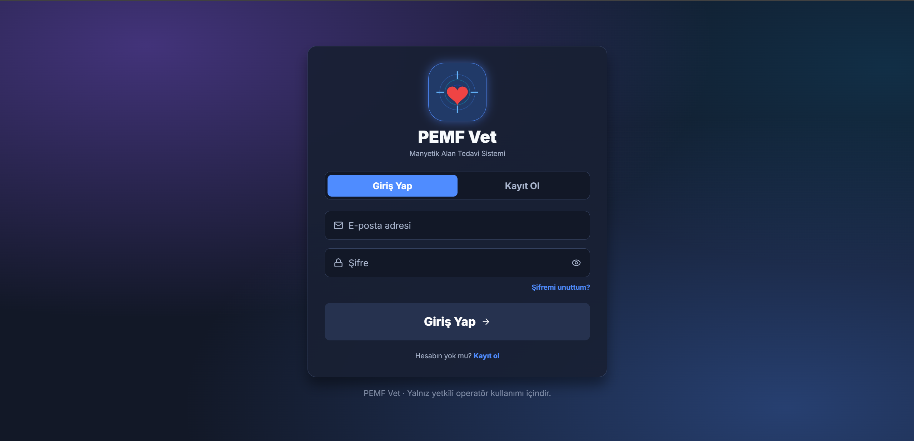
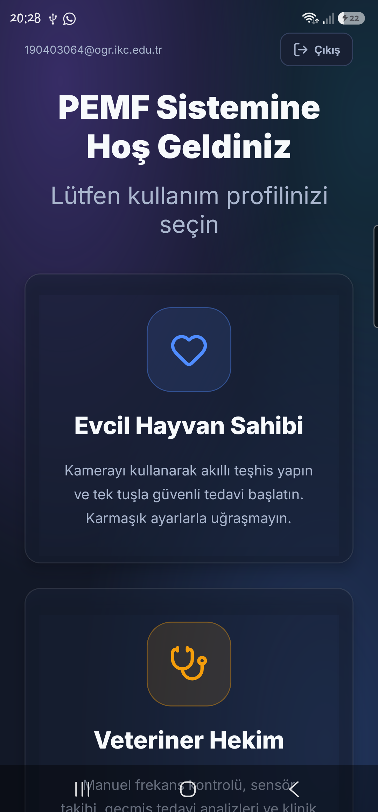
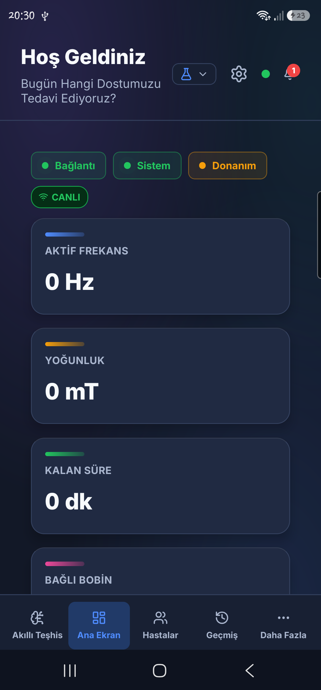
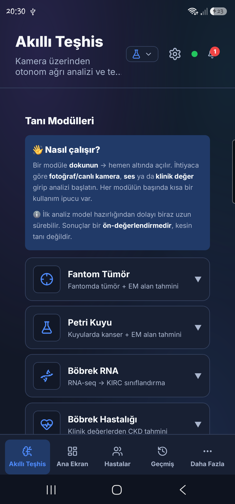
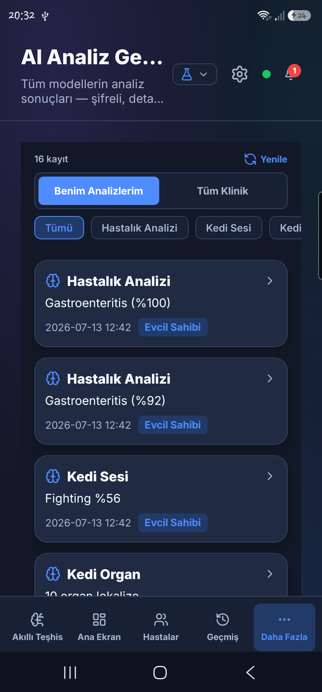

# PEMF Veteriner Cihazı — Proje Kökü (`guii`)

Bu depo, **PEMF veteriner terapi cihazının** tüm yazılımıdır: arayüzsüz (**headless**) Python backend'i,
React Native/Expo mobil+web uygulaması, yapay-zekâ teşhis modelleri, Tauri ince-istemci (launcher) ve
tüm build/dağıtım zinciri — hepsi **tek klasörde**.

> **Yeni geliştiriciysen buradan başla.** Aşağıdaki **dizin haritası** her üst-klasörün kendi `README.md`'sine
> link verir; oradan alt-sisteme inersin. Build için → [`BUILD.md`](BUILD.md). Mimari için → [`docs/ARCHITECTURE.md`](docs/ARCHITECTURE.md).

> **Önemli (AI ağırlıkları):** küçük tabular / ONNX modeller ve scaler'lar kaynakta gömülüdür; büyük ağırlıklar **profil model paketleriyle** gelir (`home.zip` / `vet.zip` / `research.zip` + büyük iki `.pt` için ayrı `research-2.zip` — manifest `model_parts`, [`build_tools/make_model_zip.py`](build_tools/README.md)). Başlatıcı profile göre indirir; kurulumdan sonra çalışma **çevrimdışıdır** (`apps/backend/utils/model_downloader.py` yalnız yerel kökleri arar — **Hugging Face indirmesi yok**). **ODAK** (AI Pro sürüşü) alan tablosu + modelleri **veteriner ve araştırma** model paketlerindedir — paket yoksa ODAK sürmez ve "AI model paketini kurun / güncelleyin" der (açık depoya girmezler). Parçası olmayan kurulumda XAI zarif düşer ("Açıklama üretilemedi").

---

## Arayüz — Ekran Görüntüleri

Arayüz **React Native / Expo** ile tek kod tabanından **Web + Android + iOS**'te çalışır. Üç profil —
**Evcil Hayvan Sahibi · Veteriner Hekim · Araştırma Modu** — arayüzü kullanıcıya göre uyarlar.

<p align="center">
  <br/>
  <em>Kimlik doğrulama — Supabase tabanlı e-posta doğrulama + şifre sıfırlama.</em>
</p>
<p align="center">
  
  
  
  
</p>
<p align="center"><em>Profil Seçimi · Araştırma Modu ana ekran · Akıllı Teşhis (AI Hub) · Şifreli AI Analiz Geçmişi.</em></p>

---

## Büyük Resim

```
Mobil/Web (apps/ui → frontend/dist)  ──LAN http/ws :8000 · uzak: Cloudflare tünel──▶  PEMF_Backend.exe
                                                                                       (FastAPI+uvicorn, NSSM servis)
   Supabase (yalnız cihaz-registry + şifreli PII)                                        ├─ apps/backend/servers/  (REST+WS+router'lar)
   GitHub Releases (OTA: base-app/APK/launcher)                                          ├─ apps/backend/controllers/ → STM32 (bobin 1-7, seri)
                                                                                         ├─ apps/backend/services/ + bin/mosquitto → ESP (slot 8, MQTT) ⚠️ 2026-09-11: ESP SÖKÜLÜ, PEMF_ESP_ENABLED=0
                                                                                         ├─ apps/backend/database/ (SQLCipher yerel)
                                                                                         └─ ai_hub/ (gömülü ONNX teşhis)
```
Detaylı bileşen diyagramı, veri akışı ve güven sınırları: [`docs/ARCHITECTURE.md`](docs/ARCHITECTURE.md).

## Sürümler — tek kaynak [`versions.json`](versions.json)

Güncel sürümler için **`versions.json`'a bak** — bu belgeye sürüm yazılmaz. (Buraya elle yazılan
tablo 2026-08-06'da donmuştu: `1.9.5 / 2.3.3` yazarken gerçek sürümler `1.9.16 / 2.3.17`ydi;
BUILD.md'deki aynı tuzakla birlikte 2026-08-18'de kaldırıldı.)

| Kanal | Hedef dosya |
|---|---|
| Backend / installer (`VERSION`) | `PEMF_Backend_Setup.iss`, `docs/version_info.txt` |
| Launcher (client) | `launcher/Cargo.toml`, `launcher/app/tauri.conf.json` |
| Mobil (APK/IPA) | `apps/ui/app.json` |
| Frontend OTA (kanal **KULLANIM DIŞI**) | `frontend_version.json` |

> Sürümü **elle `versions.json`'da** değiştir → `build_tools/sync_versions.ps1` hedef dosyalara yazar
> (build başında otomatik). CHANGELOG'suz sürüm yükseltmeyi hem pre-commit kancası
> (`scripts/check_changelog_surum.py`) hem CI (`tests/test_version_visibility.py`) durdurur.

## Depo düzeni (2026-08-18'den beri: TEK depo · TEK dal)

- **`mert61-python/pemf`** = bu depo. Eskiden ayrı depolarda duran **`apps/ui/`** (mobil/web istemci)
  ve **`apps/web/`** (ödeme/indirme sitesi) artık **burada izleniyor**; eski `pemf-frontend`
  ve `apps/web` depoları **silindi** (tam aynaları `../*-arsiv-2026-08-18.bundle` paketlerinde).
- Tek dal: **`production-hardening`** (varsayılan). Eski `main`/`vet-client`/`upload-testflight`
  uçları `arsiv/*-2026-08-18` etiketlerinde; `esp` dalı silindi — içindeki eğitim arşivi önce
  [`training_archive/`](training_archive/)'e kurtarıldı.
- **Yayın varlıkları hâlâ [`pemf-update`](https://github.com/mert61-python/pemf-update)**
  deposuna yüklenir: istemcilere **derlenmiş** sabitler orayı gösterir (`launcher/core/src/net.rs`),
  değiştirilemez. O depoya dokunma.
- Site (Vercel) bu deponun `apps/web/` alt dizininden, `production-hardening` push'uyla
  otomatik deploy edilir (Root Directory ayarlı).

---

## Dizin Haritası — Neyin Ne Olduğu

### Backend (Python, headless)
| Klasör | Ne işe yarar |
|---|---|
| `apps/backend/backend_service.py` · `apps/backend/headless_core.py` · `apps/backend/event_bus.py` | **Giriş noktası** (main), Qt-siz çekirdek (STM seri + kuyruk), pub/sub olay veri yolu |
| [`apps/backend/servers/`](apps/backend/servers/README.md) | FastAPI uygulaması: REST + WebSocket + tüm router'lar + canlı durum + ağ (tünel/mDNS/sync) |
| [`apps/backend/controllers/`](apps/backend/controllers/README.md) | STM32 bobin kontrol choke-point'i (keep-alive + süre-watchdog + garantili STOP) |
| [`apps/backend/services/`](apps/backend/services/README.md) | Mosquitto/ağ-durumu/UDP-keşif süpervizörleri + cihaz kimlik-bilgileri + DB bakımı. ⚠️ Mosquitto yolu `PEMF_ESP_ENABLED=0` iken KULLANILMAZ (ESP söküldü) |
| [`apps/backend/database/`](apps/backend/database/README.md) | Yerel SQLite/**SQLCipher** kalıcılık (hasta/seans/sensör/auth) + MQTT outbox |
| [`apps/backend/utils/`](apps/backend/utils/README.md) | STM32 seri/protokol-limit, sırlar, yollar, config, PDF, telemetri, model-çözüm (offline) |
| [`ai/`](ai/README.md) | Kural-tabanlı **tedavi-parametre önerisi** + global AI config (teşhis DEĞİL) |
| [`pemf_gui/`](pemf_gui/README.md) | Eski PyQt GUI kalıntısı — GUI ölü, ama `config.py`+ikon shim'i **canlı** (backend import eder) |
| [`config/`](config/README.md) | Uygulama config'i (MQTT/timer/performans) + `credentials/` (sır) |
| [`data/`](data/README.md) | Küçük seed/geliştirme verisi — çoğu bayat (gerçek DB app-data'da) |

### Yapay Zekâ
| Klasör | Ne işe yarar |
|---|---|
| [`ai_hub/`](ai_hub/README.md) | Teşhis modeli **kodu** (14+ model; Yara Kapanma / Scratch CPN dahil) + gömülü küçük ağırlıklar + **ODAK** (`ai_hub/odak/` — AI Pro petri / fantom / kedi faz + duty'si: CST bobin alanı + tezgâh MLX kalibrasyonu + KNN, fizikle denetimli) + **kabin kamerası sabit düzlem kalibrasyonu** (`ai_hub/cv_ortak/sabit_duzlem.py`) + `PEMF_AI_Test_Girdileri/` |
| [`ai_service/`](ai_service/README.md) | Bağımsız **GPU (CUDA) inference mikroservisi** (:8100, onnxruntime-gpu + torch cu128 — scratch CPN; opsiyonel) |
| `release_assets/` | **Model ağırlık deposu (~3,9 GB) TEK-KAYNAK** + `PEMF_Vet_Mobil.apk` — git'te yalnız [`release_assets/ai_models/`](release_assets/ai_models/) altındaki küçük dosyalar izlenir; `README.md` ve büyük ağırlıklar yalnız yerelde |
| [`training_archive/`](training_archive/) | **DONMUŞ eğitim arşivi** (doktora/TÜBİTAK; silinen `esp` dalından kurtarıldı; 435 takipli dosya — `git ls-files training_archive | wc -l`, 2026-10-28). Lint/format **muaf** — değeri sadakati; elleme |

### Frontend / Web
| Klasör | Ne işe yarar |
|---|---|
| [`apps/ui/`](apps/ui/README.md) | **ANA KAYNAK** — mobil (APK/IPA) + web bundle üreten React Native/Expo kaynağı |
| `frontend/` | **ÜRETİLEN** — `dist/` = backend'in `/` kökünden sunduğu web bundle (apps/ui'den aynalanır); `src/` ölü |
| [`apps/web/`](apps/web/README.md) | **Canlı pazarlama/indirme sitesi** (Vite+React, Vercel, iyzico ödeme) |
| [`pemf_vet_landing/`](pemf_vet_landing/NOTES.md) | Çıkarılmış Lovable landing statik kopyası (tasarım referansı) |
| [`web_static/`](web_static/README.md) · [`website/`](website/README.md) · [`templates/`](templates/README.md) | **LEGACY** — eski vanilla UI · eski indirme sayfası · eski sunucu-render şablonu (hiçbiri kullanılmıyor) |

### Build / Dağıtım / Launcher
| Klasör/Dosya | Ne işe yarar |
|---|---|
| [`BUILD.md`](BUILD.md) | **Ana build rehberi** (backend/katmanlı paket/launcher/APK/installer + yayın) |
| `scripts/bootstrap.ps1` | Sıfır-makinede tüm toolchain'i tek komutla kurar (Node/Rust/MSVC/JDK/Android/Inno/gh) |
| [`build_tools/`](build_tools/README.md) | Derleme reçeteleri (PyInstaller spec, Inno .iss, `make_base_zip.py`, `build_apk.ps1`, sürüm-lock) |
| [`scripts/`](scripts/README.md) | Ops: build/yayın/servis-kurulum/gateway-hotspot/teardown-uninstall |
| `PEMF_BUILD/` | **ÜRETİLEN** — kanonik frozen-backend çıktısı (`dist/PEMF_Backend`, katmanlı paket girdisi) |
| `build/` · `dist/` | **ÜRETİLEN** — PyInstaller varsayılan-konum ikizleri (regenerable) |
| [`pemf-app-packages/`](pemf-app-packages/README.md) | Güncelleme-sunucusu hazırlık: `base-app.zip` + `base-deps.zip` + `manifest.json` |
| [`launcher/`](launcher/README.md) | **Tauri v2 ince istemci** ("PEMF Vet Client") — indirir/doğrular/backend'i başlatır, kendini günceller |
| [`deploy/`](deploy/README.md) | `device.env` / `server.env` / `staging.env` dağıtım profilleri |
| `offline dağıtım/` | **YEREL** (git'te izlenmez, gitignore'lu) — İnternetsiz USB kurulum (Inno DiskSpanning `.bin` dilimleri) |
| `docker/` | Yalnız yerel Vault anahtar emaneti (`docker-compose.vault.yml` + `vault/config/vault.hcl`) — uygulama Docker dağıtımı Y344 ile EMEKLİ (git geçmişinde) |
| `bin/` | Gömülü ikililer: mosquitto (MQTT — ESP kapalıyken kullanılmaz), cloudflared (tünel), nssm (servis) — git'te yalnız `bin/mosquitto/` izlenir |
| `lattekurulum/` | **YEREL** (git'te izlenmez, gitignore'lu) — LattePanda klinik mini-PC kurulum yardımcıları |

### Firmware · Test · CI · Diğer
| Klasör | Ne işe yarar |
|---|---|
| [`firmware/`](firmware/README.md) | STM32F429 bobin-sürücü firmware'i (`main.c`, yazılım DDS PWM + güvenlik watchdog) |
| [`tests/`](tests/README.md) | pytest paketi (sayı belgede TUTULMAZ — `pytest --collect-only -q`; protokol-güvenlik, auth, KVKK, seans, OTA, CI-kapıları, i18n kapıları). Kapsam eşikleri CI'da ve yalnız YÜKSELİR (backend · istemci jest · site vitest · başlatıcı cargo) |
| [`tools/`](tools/README.md) | Geliştirici araçları (STM32 simülatör :5100, COM sniffer, test-verisi) + **uçtan uca testler** `tools/e2e_smoke.py` / `tools/e2e_full.py` (gerçek backend ayrı süreçte, alt port, sanal donanım) |
| [`.github/`](.github/README.md) | CI (tests/lint/security/**frontend/site**/linux-mac backend/launcher) + dependabot — **yalnız KÖK `.github/` geçerli** (TestFlight iş akışı arşivli, S-4B.4) |
| [`docs/`](docs/README.md) | Dokümanlar (mimari, launcher-sözleşmesi, runbook, doğrulama, sistem-raporu) + ekran görüntüleri |
| `apple-mac-cert/` | **YEREL** (git'te izlenmez, gitignore'lu — kapı ölçer) — ⚠️ Apple kod-imzalama/notarization materyali (SIR — rotate gerekir) |
| [`dema-terapi-simülatörü/`](dema-terapi-simülatörü/README.md) | Bağımsız demo terapi simülatörü (React+Vite; backend'e bağlı değil) |

---

## Build & Dağıtım (özet)

> **Sıfırdan bir makinede mi başlıyorsunuz?** → **[`docs/TEMIZ-MAKINE.md`](docs/TEMIZ-MAKINE.md)**:
> klinikte kurup-kullanma (Yol A) ile build/yayın (Yol B, sır geri-yükleme dahil) akışını
> temiz ve sıralı anlatır. Aşağısı ve `BUILD.md` başvuru derinliğidir.

Tam adım-adım: **[`BUILD.md`](BUILD.md)**. En kısa hâli (guii kökünden):

| Hedef | Komut | Çıktı |
|---|---|---|
| Backend (frozen EXE) | `.\scripts\build_backend_exe.ps1` | `PEMF_BUILD\dist\PEMF_Backend\` |
| Katmanlı runtime (base-app + base-deps) | `python build_tools\make_base_zip.py` | `pemf-app-packages\base-app.zip` + `base-deps.zip` |
| Launcher (installer) | `cd launcher\app; npx @tauri-apps/cli build` | `...\nsis\...setup.exe` |
| Web frontend | `cd apps/ui; npm run export:web` + mirror | `frontend\dist` |
| Android APK | `.\build_tools\build_apk.ps1` | `release_assets\PEMF_Vet_Mobil.apk` |

- **Runtime taşınabilir:** frozen EXE / offline installer Python KURULU OLMADAN her makinede çalışır.
- **Build taşınabilir değil ama otomatik:** `scripts/bootstrap.ps1` boş bir Windows'ta tüm araç zincirini kurar.
- **Build Python'ı = gömülü** (klasör kökündeki `python.exe`; myenv + sistem Python **kaldırıldı**, gerekmez).
- Dağıtım (device/server): [`deploy/README.md`](deploy/README.md).

## Önemli Kurallar (yeni geliştirici — bunları bozma)

- 🔒 **Cihaz güvenliği:** bobinler her kill/kaldırmadan **önce** E-stop'lanır (launcher + teardown). Süre-watchdog + keep-alive + firmware "Ölü Adam Devresi" katmanlı korumadır.
- 🔒 **Backend Python-tarafı MAKS DUTY clamp'i YOK** (bilinçli, `STM32_DUTY_MAX_RATIO = None`; sıcaklık eşiği / termal kesme de YOK — A-47) — duty üst sınırı firmware'dedir ve TAŞIYICIDIR (kip tavanının üstü NACK: bipolar 0,5 · unipolar 1,0; ISR bipolar klempi `tpp/2 − DDS_BIPOLAR_GAP_TICKS` — shoot-through). **Frekans ise Python'da kırpılır:** STM 1-25000 Hz (`normalize_frequency_hz`), ESP 1-1000 Hz (`normalize_esp_frequency_hz`, 8266 firmware sınırı), AI Pro duty tavanı %50 (`AI_PRO_DUTY_MAX_RATIO`). Sınır sabitleri `apps/backend/utils/stm32_protocol_limits.py`.
- 🔒 **PII maskeleme varsayılan KAPALI** (bilinçli sahip kararı) — `PEMF_MASK_HISTORY_PII=1` ile açılır.
- 🌐 **AI offline** — `apps/backend/utils/model_downloader.py` yalnız yerel kökleri arar; internetten model çekmez.
- ✏️ Web/mobil UI'yi **`apps/ui/`'te düzenle** — `frontend/` yalnız üretilen `dist` aynasıdır (takipli `frontend/src` YOK — `git ls-files frontend` boş).
- 🚀 **Launcher AYRI yayınlanır** (base-app/APK republish onu güncellemez).
- 🌍 **Çok dillilik (TR + EN):** kullanıcıya görünen her metin katalogdan gelir; yeni metin **iki dilde birlikte** eklenir, var olan Türkçe bayt bayt aynı kalır. İngilizce **AÇIK** (`i18n/bayrak.json` → `I18N_EN_ACIK: true`). Kısa kural: [`CLAUDE.md`](CLAUDE.md) · ayrıntı: [`i18n/KURALLAR.md`](i18n/KURALLAR.md) · göç durumu: `i18n/kapsam.json` · araçlar `scripts/i18n/`.

---
İlgili: [BUILD.md](BUILD.md) · [docs/ (doküman indeksi)](docs/README.md) · [ARCHITECTURE.md](docs/ARCHITECTURE.md) · [RUNBOOK.md](docs/RUNBOOK.md)

## Son değişiklikler — Kasım 2026 (geliştirme dalı; bir kısmı henüz yayında değil)

Ayrıntı ve yayın durumu: [`CHANGELOG.md`](CHANGELOG.md). Eski "2026-08-06" tablosu CHANGELOG'da.

| Alan | Değişiklik |
|---|---|
| **AI Pro → ODAK** | Petri (kuyucuk / tüm petri), fantom ve kedi için **faz + duty** artık `ai_hub/odak/` modelinden: CST bobin alanı × tezgâhta MLX ile ölçülen kalibrasyon (veri kökünde `kabin_kalibrasyonu/alan_kalibrasyonu.json`) → KNN (k = 1, yerel alan). Kullanıcı **dozu seçer** (tepe \|B\| mT; üst sınır o konumda duty ≤ %50 tavanı); her öneri **fizikle denetlenir** (zaman domeni tepe \|B\|, doz sapması > %10 → SÜRMEZ, eylem söyleyen neden). Onay ekranı: doz ± konum payı, tavan, çevre oranı, frekans seçici, petride 24 kuyu haritası. Hocanın em_* modelleri silinmedi ama **sürüş kaynağı değil**. Fantom sürüşü doğrulanana dek kapalı; kedi sürüşü bayrakla kapalı. |
| **Kabin kamerası** | Üst kapağa sabit kamera + **sabit düzlem kalibrasyonu** (iki konumlu, ArUco'suz; araştırma profilinde kalibrasyon ekranı, "Doğrula" ≤ 2 cm), kör bölge uyarısı, numune altlığı, kamera kimliği ad + VID/PID ile (sıra değişse de doğru kamera). Kedi hattı ArUco'yu kullanmaya devam eder. |
| **Manyetik alan sensörü** | MLX90393 sıfır kayması backend'de çıkarılır (bobinler kapalıyken ölçülen eksen merkezi); firmware kayıp sensörü kendisi yeniden arar, 10 sn içinde dönmezse uygulama bir kez "sensör düştü" uyarısı verir. |
| **Güncelleme** | Yeni sürüm **kullanıcı onayıyla** iner ve kurulur (tek pencere, "Şimdi değil"); seans sürerken bekler, bitince bobinler durdurulup kurulur ve uygulama yeniden başlar. |
| **İkinci Windows hesabı** | Başlatıcıdaki paylaşım kartı veri dizinini "PEMF Data Users" grubuyla ikinci hesaba açar (tek yönetici onayı); erişim yokken uygulama sonsuz yüklenmek yerine nedenini söyler. Güvenlik duvarı "İzin ver" yalnız PEMF'in kendi backend'i ve mosquitto'su için Windows engel kuralını kaldırıp izin kurar. |
| **Bağlantı / ACİL DURDUR** | Mobil yeniden bağlanma hızlandı; boşta kapanışta ve bağlantı yokken gereksiz mandal bandı kalktı; ESP satırları gizli (ESP kodu silinmedi). Çevrimdışı açılan istemci ağ gelince çevrimiçine döner. |
| **Dil** | İngilizce arayüz açık; her yeni metin TR + EN birlikte. |

Yayındaki sürümler için **[`versions.json`](versions.json)**'a bakın — bu belgeye sürüm yazılmaz
(bkz. yukarıdaki *Sürümler* bölümü). Senkronizasyon: `build_tools/sync_versions.ps1`.

> ⚠️ Burada elle yazılmış bir sürüm tablosu vardı ve **üçüncü kez** bayatlamıştı: `1.9.5 /
> 1.9.9 / 2.3.3` yazarken gerçek sürümler `1.9.50 / 1.9.51 / 2.3.34`tü. Aynı belgenin 47.
> satırı zaten "bu belgeye sürüm yazılmaz" diyordu — kural vardı, **onu zorlayan kapı yoktu**.
> Artık var: `tests/test_readme_surum_bayatlamaz.py`.
